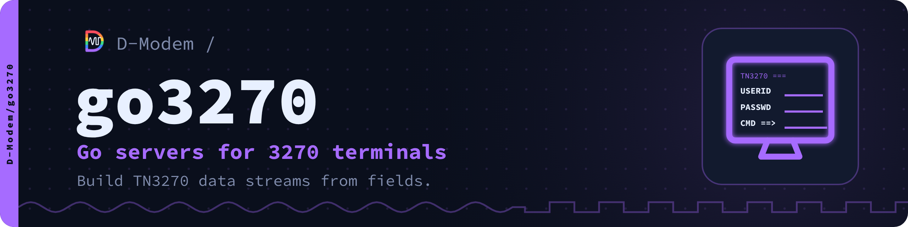

# go3270

A Go library to write TN3270 servers. It builds 3270 data streams from
fields. It reads back the attention key and the values that the user typed.

This is the fork of [racingmars/go3270](https://github.com/racingmars/go3270)
by Matthew R. Wilson for the D-Modem suite. Its API stays compatible with the
API of racingmars/go3270. [bbs](https://github.com/D-Modem/bbs) uses it for
its TN3270 callers.

- Screens from fields, with `ShowScreenOpts()`, `HandleScreen()` and `RunTransactions()`
- Telnet negotiation, detection of the terminal size, and screens larger than 24x80
- 31 EBCDIC code pages, detected from the client, and graphic escape (code page 310)
- In this fork: the library keeps all query replies. Programmed symbols, native 3270 vector graphics and images
- In this fork: IND$FILE file transfer (DFT), the side of the host
- `cmd/gfxtest`, a TN3270 server to try graphics on an emulator

## Quick start

    go get github.com/D-Modem/go3270

```go
import "github.com/D-Modem/go3270"
```

Then refer to `example1` to `example5`. `example4` shows the recommended
`RunTransactions()` structure. If your code imported
`github.com/racingmars/go3270`, change only its import path.

## Documentation

The documentation is also a website, [d-modem.github.io/go3270](https://d-modem.github.io/go3270/), with reference pages made from the code.

- [docs/](docs/README.md): usage, code pages, graphics and IND$FILE, references
- [API reference](https://pkg.go.dev/github.com/D-Modem/go3270)
- [Documentation style](docs/STYLE.md): the rules for ASD-STE100 Simplified Technical English

## The D-Modem suite

| Repository | What it is |
| --- | --- |
| [D-Modem](https://github.com/D-Modem/D-Modem) | The open V.92 softmodem: dmodemd, libdmodem and the Asterisk, FreeSWITCH and ARI modules |
| [app](https://github.com/D-Modem/app) | The D-Modem app for Android and iOS: a dial-up modem on a SIP call |
| [hardware](https://github.com/D-Modem/hardware) | pico-serial: RP2040 serial adapters and phone-line USB sticks |
| [menu](https://github.com/D-Modem/menu) | modemmenu: the login and menu dial-up callers reach |
| [bbs](https://github.com/D-Modem/bbs) | A bulletin board for telnet, SSH, TN3270 and modem callers |
| [go3270](https://github.com/D-Modem/go3270) | A Go library for 3270 terminal servers, used by bbs |
| [brand](https://github.com/D-Modem/brand) | Logos, colours, type and the naming guide |

## Licence

AGPL-3.0-only ([LICENSE](LICENSE)), or a commercial licence from the D-Modem Authors ([COMMERCIAL-LICENSE.md](COMMERCIAL-LICENSE.md)). The code from upstream stays under its MIT licence ([LICENSE-MIT](LICENSE-MIT)) as well. The `SPDX-License-Identifier` line of each file tells which licence applies to it. Contributions come with a contributor agreement ([CONTRIBUTING.md](CONTRIBUTING.md)).
